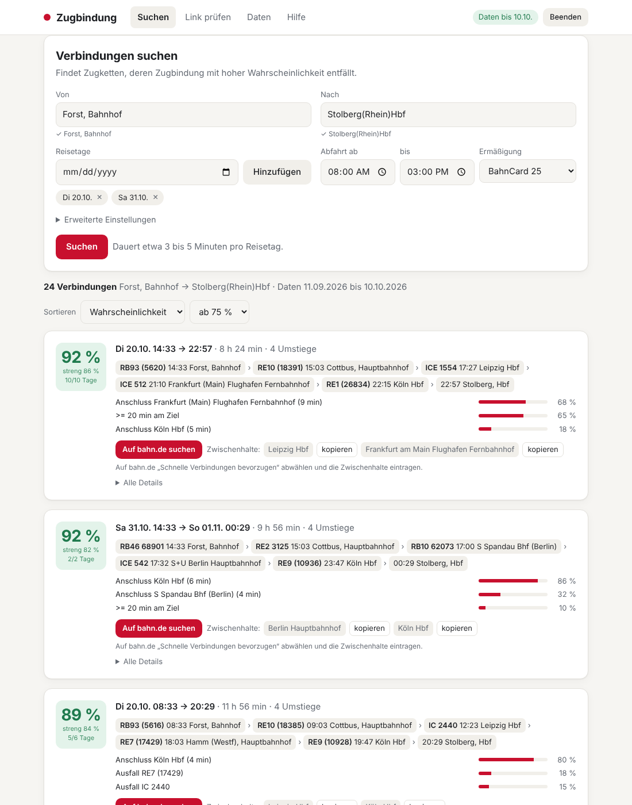

# zugbindung

Ein Programm, das Bahnverbindungen findet, bei denen die **Zugbindung eines Sparpreis-Tickets mit hoher Wahrscheinlichkeit entfällt**. Grundlage sind echte Verspätungsdaten der Deutschen Bahn aus den letzten Wochen. Es läuft als **App im Browser** auf deinem eigenen Rechner, ein Terminal ist nicht nötig.

Die Idee dahinter: Du willst z. B. von **Berlin nach Köln**. Gebucht wird ein günstiger Sparpreis (z. B. 13,49 € mit BahnCard 25) für eine **längere** Strecke, die Berlin → Köln einschließt, etwa Frankfurt (Oder) → Aachen, und zwar über eine Zugkette mit vielen knappen Umstiegen. Reißt diese Kette, entfällt die Zugbindung. Das Ticket gilt dann laut DB bis zu einem Jahr lang für eine Verbindung freier Wahl. Davon fährst du nur das Stück Berlin → Köln: späterer Einstieg, früherer Ausstieg und eine andere Route sind erlaubt, solange die Strecke plausibel ist.



---

## Schnellstart: App per Doppelklick

1. **Herunterladen:** Auf der GitHub-Seite dieses Projekts auf **„Code“ → „Download ZIP“** klicken und das ZIP entpacken (z. B. in `Dokumente/zugbindung`). Wer git kennt, kann auch `git clone https://github.com/Pustimba/karten.git` nutzen.
2. **Starten** per Doppelklick:

   | System | Datei | Beim ersten Start |
   |---|---|---|
   | **macOS** | `Start-Mac.command` | **Empfohlen:** Terminal öffnen, `bash ` (mit Leerzeichen) eintippen, `Start-Mac.command` aus dem Finder ins Fenster ziehen, Enter. Ein direkter Doppelklick wird beim ersten Mal oft blockiert („Apple konnte nicht überprüfen …“ oder „nicht über die notwendigen Zugriffsrechte“), siehe [Startdatei auf dem Mac freigeben](#startdatei-auf-dem-mac-freigeben). |
   | **Windows** | `Start-Windows.bat` | Zeigt Windows „Der Computer wurde durch Windows geschützt“: **Weitere Informationen → Trotzdem ausführen**. |
   | **Linux** | `start-linux.sh` | Im Dateimanager „Als Programm ausführen“ wählen, oder im Terminal `./start-linux.sh`. |

   Beim allerersten Start installiert die Datei automatisch [uv](https://docs.astral.sh/uv/) (ein kleines Werkzeug, das Python und die nötigen Pakete bereitstellt). Das dauert ein bis zwei Minuten. Danach öffnet sich die App im Browser unter `http://127.0.0.1:8765`.
3. **Daten laden:** Beim ersten Mal zeigt die App „Jetzt Daten laden“. Klicken und warten (ca. 5,5 GB Download, 30 bis 60 Minuten, Fortschritt wird angezeigt). Danach etwa einmal pro Woche unter **Daten** auf „Daten aktualisieren“ klicken.
4. **Suchen:** Start, Ziel und Reisetage eingeben, auf **Suchen** klicken.
5. **Beenden:** oben rechts auf **Beenden** klicken, oder das schwarze Fenster schließen, das beim Start aufgegangen ist.

Das Fenster mit dem Text „Zugbindung läuft unter http://127.0.0.1:8765/“ muss geöffnet bleiben, solange du die App nutzt. Die App ist nur auf deinem eigenen Rechner erreichbar.

### Startdatei auf dem Mac freigeben

Beim ersten Doppelklick auf `Start-Mac.command` können zwei Meldungen erscheinen:

* **„Apple konnte nicht überprüfen, ob … frei von Schadsoftware ist“:** Die Datei stammt aus dem Internet und ist nicht von Apple signiert. Ab macOS 15 (Sequoia) gibt es in diesem Fenster keinen „Öffnen“-Knopf mehr.
* **„… konnte nicht ausgeführt werden, da du nicht über die notwendigen Zugriffsrechte verfügst“:** Beim Entpacken ging das Recht „ausführbar“ verloren.

**Am einfachsten für beide Fälle:** Terminal öffnen (Cmd + Leertaste, „Terminal“), `bash ` mit Leerzeichen eintippen, `Start-Mac.command` aus dem Finder ins Terminalfenster ziehen und **erst dann** Enter drücken. `bash` und der Pfad müssen in einer Zeile stehen:

```bash
bash /Users/DEINNAME/Downloads/karten-main/Start-Mac.command
```

Die Startdatei muss im entpackten Projektordner liegen (neben `pyproject.toml` und dem Ordner `zugbindung`); eine einzeln heruntergeladene Startdatei funktioniert nicht. Wer schon im Projektordner ist, tippt einfach `bash Start-Mac.command`.

Wer danach dauerhaft per Doppelklick starten möchte, erledigt einmalig beides im Terminal (jeweils den Ordner bzw. die Datei ins Fenster ziehen statt den Pfad zu tippen):

```bash
chmod +x ~/Downloads/karten-main/Start-Mac.command
xattr -dr com.apple.quarantine ~/Downloads/karten-main
```

Alternativ zur zweiten Zeile geht die Freigabe auch ohne Terminal:

**Freigabe über die Systemeinstellungen:**

1. Im Hinweisfenster auf **Fertig** klicken.
2. **Systemeinstellungen** → **Datenschutz & Sicherheit** öffnen und ganz nach unten scrollen.
3. Bei „„Start-Mac.command“ wurde blockiert …“ auf **Dennoch öffnen** klicken und mit Passwort oder Touch ID bestätigen.
4. `Start-Mac.command` erneut doppelklicken und **Dennoch öffnen** wählen.

Wer das Projekt per `git clone` holt, bekommt keine der beiden Sperren.

### Die App im Überblick

| Bereich | Was du dort machst |
|---|---|
| **Suchen → Beste Reisetage** (Standard) | 1. Eintragen, wo du **wirklich** fahren willst, z. B. Berlin Hbf → Köln Hbf. 2. **„Passende Bahnhöfe vorschlagen“**: die App findet Bahnhöfe vor deinem Start (z. B. Frankfurt (Oder), Eberswalde) und hinter deinem Ziel (z. B. Aachen, Eschweiler), über die ein Ticket deine Strecke plausibel einschließt. Per Klick an- oder abwählen; eigene Bahnhöfe lassen sich ergänzen. 3. Zeitraum, Wochentage, Höchstpreis und Ermäßigung wählen, **Suchen**. Die App fragt **bahn.de** für jede Ticket-Variante (jede Kombination aus Start und Ziel, deine Wunschstrecke selbst immer eingeschlossen) und jeden Tag ab, behält Verbindungen bis zum Höchstpreis und sortiert sie nach der Wahrscheinlichkeit, dass die Zugbindung entfällt. Jede Karte zeigt Preis, Ticket-Strecke, Zugkette, Hauptrisiken, einen Knopf **„Auf bahn.de suchen“** (Suche vorbefüllt) und die **Zwischenhalte** zum Kopieren. Filter nach Tag und Ticket-Variante, Sortierung nach Wahrscheinlichkeit oder Preis, dazu eine Übersicht nach Reisetag. |
| **Suchen → Zugketten erkunden** | Ohne bahn.de und ohne Preise: sucht über Transitous typische Zugketten für einzelne Reisetage. Nützlich, wenn bahn.de gerade blockt, oder um Muster zu finden. |
| **Link prüfen** | Einen oder mehrere bahn.de-Links (über „Teilen“ auf bahn.de) einfügen. Die App bewertet die Verbindung mit den echten Zugnummern. |
| **Daten** | Zeigt, bis wann Verspätungsdaten vorliegen, und aktualisiert sie per Klick. Ein Abbruch ist jederzeit möglich. |
| **Hilfe** | Kurzanleitung und Erklärung der Zahlen. |

**Dauer der Suche:** Die App fragt bahn.de höflich mit etwa 2 Sekunden Pause zwischen den Anfragen ab. Pro Ticket-Variante und Tag sind das meist 15 bis 30 Sekunden. Die geschätzte Dauer steht neben dem Suchknopf. Runde 2 kostet je Knoten etwa 40 % zusätzlich. Mehr als 900 Kombinationen aus Varianten, Tagen und Knoten lehnt die App ab; dann weniger Bahnhöfe oder einen kürzeren Zeitraum wählen. Bewährt hat sich: zwei Starts, zwei Ziele, zwei Wochen.

**Wie die Vorschläge entstehen:** Kandidaten sind Bahnhöfe mit direkten Regional- oder Fernzügen zu deinem Start (bzw. von deinem Ziel) laut Verspätungsdaten, dazu Bahnhöfe, die mit **einem Umstieg** an einem dieser Knoten angebunden sind (z. B. Guben oder Cottbus über Frankfurt (Oder)); die Karte zeigt dann „über …“. Alle bleiben nur, wenn die Strecke plausibel ist: Der Weg Kandidat → Start → Ziel ist höchstens 30 % länger als die Luftlinie Kandidat → Ziel, sonst nichts. Lage und Richtung spielen keine Rolle: Potsdam → Berlin → Köln (12 % Umweg) ist ebenso plausibel wie Berlin → Köln → Bonn (5 %) oder → Koblenz (19 %); Rostock → Berlin → Köln (35 %) dagegen nicht. Die Liste zeigt bis zu 14 Orte je Seite, gemischt nach Himmelsrichtungen (damit z. B. hinter Köln sowohl Aachen und Stolberg als auch Koblenz und Duisburg zur Wahl stehen); Orte näher als 5 km zueinander werden zusammengefasst, Bahnhöfe im selben Ort ausgelassen. Tipp: Kleinere Orte hinter einem großen Knoten (Stolberg hinter Aachen, Lübbenau vor Berlin) erzwingen eine zusätzliche Nahverkehrsetappe und machen die Kette oft wackliger, ohne den Preis stark zu treiben. **Selbst eingetragene Bahnhöfe** (z. B. Forst (Lausitz)) prüft die App genauso; passt einer nicht, erscheint er mit ⚠ und Grund (z. B. „35 % Umweg“) und ist abgewählt; per Klick lässt er sich trotzdem auswählen. Die gebuchte Kette selbst muss weder über deinen Wunsch-Start noch über dein Wunsch-Ziel laufen; die Prüfung betrifft nur die Ticket-Strecke.

**Zwei Runden:** In Runde 1 fragt die App bahn.de ganz normal für jede Ticket-Variante ab. Danach wählt sie aus allen gefundenen Ketten die Umstiegsbahnhöfe, an denen Anschlüsse am häufigsten reißen (Bahnhöfe in deiner Start- oder Zielstadt ausgenommen). In Runde 2 fragt sie bahn.de erneut ab, jeweils mit einem dieser Knoten als Zwischenhalt. So erscheinen Umwegketten, die bahn.de bei einer normalen Suche ausblendet. Wie viele Knoten, steht unter **Erweiterte Einstellungen** (0 bis 4, Standard 2). Ergebnisse aus Runde 2 tragen den Hinweis „gefunden mit Zwischenhalt …“, und dieser Knoten steht dann zuerst in den Zwischenhalten zum Kopieren.

**Nur DB-Züge:** bahn.de zeigt auch FlixTrain-Verbindungen an. Die App verwirft alle Ketten mit FlixTrain, Nachtzügen anderer Bahnen (Nightjet, EuroNight) und ausländischen Betreibern, weil ein DB-Sparpreis dafür nicht gilt.

Unter **Erweiterte Einstellungen** lassen sich die Navigator-Schwelle, die Zahl der erzwungenen Knoten und (im Modus „Zugketten erkunden“) Abfrageraster, kürzester erlaubter Umstieg und die Wochentage der Vergangenheit einstellen. Die Bedeutung der Zahlen steht in [Abschnitt 11](#11-so-liest-du-die-ergebnisse), die Strategie in [Abschnitt 10](#10-strategie-und-erkenntnisse-stand-oktober-2026).

---

## Inhalt

1. [Die Regeln der DB](#1-die-regeln-der-db)
2. [Was das Tool macht](#2-was-das-tool-macht)
3. [Voraussetzungen](#3-voraussetzungen)
4. [Installation für die Kommandozeile](#4-installation-für-die-kommandozeile)
5. [Schritt 1: Verspätungsdatenbank bauen](#5-schritt-1-verspätungsdatenbank-bauen)
6. [Schritt 2: Verbindungen suchen und bewerten](#6-schritt-2-verbindungen-suchen-und-bewerten)
7. [Schritt 3: Preis auf bahn.de prüfen](#7-schritt-3-preis-auf-bahnde-prüfen)
8. [Schritt 4: bahn.de-Link prüfen](#8-schritt-4-bahnde-link-prüfen)
9. [Schritt 5: Buchen und am Reisetag beobachten](#9-schritt-5-buchen-und-am-reisetag-beobachten)
10. [Strategie und Erkenntnisse (Stand Oktober 2026)](#10-strategie-und-erkenntnisse-stand-oktober-2026)
11. [So liest du die Ergebnisse](#11-so-liest-du-die-ergebnisse)
12. [Daten aktuell halten](#12-daten-aktuell-halten)
13. [Optional: delay_bahn-Weboberfläche mit Schalter für langsame Verbindungen](#13-optional-delay_bahn-weboberfläche-mit-schalter-für-langsame-verbindungen)
14. [Grenzen der Rechnung](#14-grenzen-der-rechnung)
15. [Fehlerbehebung](#15-fehlerbehebung)
16. [Aufbau des Repos](#16-aufbau-des-repos)
17. [Datenquellen und Lizenzen](#17-datenquellen-und-lizenzen)

Die Abschnitte 4 bis 9 beschreiben die Kommandozeile. Alles davon geht auch in der App; die Erklärungen zu bahn.de, Buchung und Reisetag (Abschnitte 7 und 9) gelten für beide Wege.

---

## 1. Die Regeln der DB

Laut DB-FAQ ["Zugbindung aufgehoben"](https://www.bahn.de/faq/zugbindung-aufgehoben-bedeutung) entfällt die Zugbindung bei:

| Auslöser | Misst das Tool? |
|---|---|
| voraussichtlich **mindestens 20 Minuten Verspätung am Ziel** (national) | ja |
| **Zugausfall** | ja |
| **Haltausfall** | ja (Ausfall am Ein- oder Ausstiegshalt) |
| **verpasster Anschlusszug** | ja |
| **Fahrplanänderung mit verfrühter Abfahrt** | aus Echtzeitdaten unmöglich zu messen, siehe [Abschnitt 10](#10-strategie-und-erkenntnisse-stand-oktober-2026) |

Danach gilt laut derselben FAQ:

* Mit einem Fernverkehrsticket darfst du alle DB-Fernzüge (ICE, IC/EC) und Nahverkehrszüge nutzen.
* Die Strecke zum Zielort ist frei wählbar.
* Im Fernverkehr ist auch eine frühere Verbindung am selben Reisetag erlaubt.
* Eine spätere Verbindung ist bis zu **einem Jahr** nach dem ursprünglichen Reisedatum möglich.
* Innerhalb Deutschlands brauchst du keine Bescheinigung.
* Reservierungen gelten nur für den gebuchten Zug.
* Ein späterer Einstieg an einem Unterwegsbahnhof und ein früherer Ausstieg vor dem Ziel sind üblicherweise erlaubt (siehe z. B. [drivest.de](https://drivest.de/4353/bahn-darf-man-an-einem-spaeteren-bahnhof-einsteigen-als-gebucht) und [bahn-tickets.com](https://www.bahn-tickets.com/nachrichten/falscher-start-zielbahnhof-bahnticket-einsteigen-aussteigen/)). Darauf beruht die Idee, ein längeres Ticket nur für einen Teil der Strecke zu nutzen.

Weil das Ticket danach ein Jahr flexibel ist, spielt das **Reisedatum der gebuchten Verbindung keine Rolle**. Es zählt allein, wie wahrscheinlich die Kette reißt, und dass der Preis passt.

> Prüfe die Regeln vor jeder Buchung auf bahn.de. Sie können sich ändern, und dieses Tool gibt nur Wahrscheinlichkeiten aus vergangenen Wochen wieder.

---

## 2. Was das Tool macht

```
                ┌──────────────────────┐
  Transitous ──▶│ 1. Verbindungen      │  viele Verbindungen A → B für einen Tag,
  (Fahrplan)    │    einsammeln        │  im Raster von z. B. 30 Minuten
                └──────────┬───────────┘
                           ▼
                ┌──────────────────────┐
  DB-Echtzeit ─▶│ 2. jede Fahrt den    │  Zugnummer/Linie + Halt + Sollzeit
  (IRIS, 30 T.) │    Verspätungsdaten  │  → Verspätung und Ausfall an jedem
                │    zuordnen          │    der letzten ~30 Tage
                └──────────┬───────────┘
                           ▼
                ┌──────────────────────┐
                │ 3. jeden Tag         │  Ausfall? Anschluss weg? Ziel ≥ 20 min?
                │    nachspielen       │  → Anteil der Tage mit Auslöser
                └──────────┬───────────┘
                           ▼
                     Rangliste (.md, .json)
```

Die App und die Kommandozeile nutzen denselben Kern. Befehle:

| Befehl | Zweck | Dauer |
|---|---|---|
| `zugbindung` oder `zugbindung app` | startet die App im Browser (das machen auch die Startdateien) | sofort |
| `zugbindung db-bauen` | lädt die DB-Echtzeitdaten der letzten 31 Tage und baut daraus eine Datenbank | einmalig ca. 30 bis 60 Minuten |
| `zugbindung suche` | sucht Verbindungen für einen oder mehrere Tage und bewertet sie | ca. 3 bis 5 Minuten pro Tag |
| `zugbindung pruefe` | bewertet eine konkrete Verbindung aus einem bahn.de-Link | wenige Sekunden |

---

## 3. Voraussetzungen

* **Python 3.12 oder neuer**
* **[uv](https://docs.astral.sh/uv/)** (Paketmanager für Python)
* **git** (optional; ohne git lädt das Programm delay_bahn als ZIP von GitHub)
* **ca. 10 GB freier Speicher** (Rohdaten ca. 5,5 GB, Zwischendateien und Datenbank ca. 3 GB)
* **mindestens 8 GB RAM**; beim Parsen braucht jeder Prozess etwa 1,5 GB
* Internetzugang zu `huggingface.co`, `api.transitous.org`, `github.com` und `www.bahn.de`

Das Tool läuft auf macOS, Linux und Windows. Python und uv richten die Startdateien bei Bedarf selbst ein.

---

## 4. Installation für die Kommandozeile

### uv installieren (einmalig)

macOS und Linux:

```bash
curl -LsSf https://astral.sh/uv/install.sh | sh
```

Windows (PowerShell):

```powershell
powershell -ExecutionPolicy ByPass -c "irm https://astral.sh/uv/install.ps1 | iex"
```

Danach ein neues Terminal öffnen, damit `uv` gefunden wird.

### Repo holen und einrichten

```bash
git clone https://github.com/pustimba/karten.git
cd karten
uv sync
```

`uv sync` legt eine eigene Python-Umgebung in `.venv/` an und installiert die zwei Abhängigkeiten (`duckdb`, `curl_cffi`).

Test:

```bash
uv run zugbindung --help
```

### Ordnerstruktur

Das Tool erwartet die Verspätungsdaten standardmäßig in einem Ordner `delay_bahn` **neben** diesem Repo:

```
irgendwo/
├── karten/        ← dieses Repo
└── delay_bahn/    ← wird von "db-bauen" automatisch angelegt
```

Wer einen anderen Ort möchte, setzt die Umgebungsvariablen `DELAY_BAHN_DIR` (Ordner) oder `ZUGBINDUNG_DB` (direkt die Datei `delays.duckdb`), oder gibt bei jedem Aufruf `--delay-bahn` bzw. `--db` an.

---

## 5. Schritt 1: Verspätungsdatenbank bauen

```bash
uv run zugbindung db-bauen
```

Das passiert dabei:

1. Das Projekt [sha2nkt/delay_bahn](https://github.com/sha2nkt/delay_bahn) wird nach `../delay_bahn` geklont (inklusive Submodul `deutsche-bahn-data`), und `uv sync` richtet dessen Umgebung ein.
2. `tools/parallel_parse.py` lädt die Rohdaten der letzten 31 Tage vom HuggingFace-Datensatz [piebro/deutsche-bahn-data](https://huggingface.co/datasets/piebro/deutsche-bahn-data) (ca. 5,5 GB) und parst die Tage **parallel**. Das Original-Skript von delay_bahn arbeitet die Tage nacheinander ab und braucht dafür über zwei Stunden.
3. `pipeline/build_delay_db.py` und `pipeline/merge_delays.py` aus delay_bahn führen die Tage zur Datei `../delay_bahn/data/delays.duckdb` zusammen.

Optionen:

| Option | Standard | Bedeutung |
|---|---|---|
| `--tage N` | 31 | wie viele Tage Daten |
| `--bis JJJJ-MM-TT` | gestern | letzter Tag |
| `--prozesse N` | Anzahl CPU-Kerne, höchstens 4 | parallele Prozesse beim Parsen; bei wenig RAM auf 2 senken |
| `--delay-bahn PFAD` | `../delay_bahn` | wohin delay_bahn geklont wird |

Am Ende steht:

```
Fertig: /…/delay_bahn/data/delays.duckdb
```

> Ein Abbruch ist unkritisch. Beim nächsten Aufruf werden bereits geladene und geparste Tage übersprungen.

---

## 6. Schritt 2: Verbindungen suchen und bewerten

Beispiel: alle Verbindungen von Forst (Lausitz) nach Stolberg (Rheinl) Hbf an zwei Tagen, Abfahrten zwischen 5 und 19 Uhr:

```bash
uv run zugbindung suche \
  --von "Forst (Lausitz)" \
  --nach "Stolberg (Rheinl) Hbf" \
  --datum 2026-10-20 2026-10-23 \
  --ab 05:00 --bis 19:00
```

Unter Windows (PowerShell) statt `\` am Zeilenende einen Backtick `` ` `` verwenden oder alles in eine Zeile schreiben.

Ablauf:

1. Start und Ziel werden bei Transitous gesucht. **Prüfe den ausgegebenen Namen** (`Suche Forst, Bahnhof → Stolberg(Rhein)Hbf`). Ist es der falsche Halt, siehe [Fehlerbehebung](#15-fehlerbehebung).
2. Für jeden Tag fragt das Tool im 30-Minuten-Raster Verbindungen ab, einmal mit allen Zügen und einmal ohne ICE (das liefert die langsamen Nahverkehrsketten). Zwischen zwei Anfragen liegen 1,5 Sekunden Pause.
3. Verbindungen mit FlixTrain, Nachtzügen anderer Bahnen oder Umstiegen unter 4 Minuten fliegen raus, weil sie sich nicht als DB-Sparpreis buchen lassen.
4. Jede verbleibende Verbindung wird bewertet.

Ausgabe: die besten 10 im Detail im Terminal, dazu im Ordner `ergebnisse/` eine Tabelle (`.md`) und alle Details (`.json`).

### Alle Optionen von `suche`

| Option | Standard | Bedeutung |
|---|---|---|
| `--von`, `--nach` | Pflicht | Bahnhofsname oder Transitous-ID |
| `--datum` | Pflicht | ein oder mehrere Tage `JJJJ-MM-TT`; muss im Fahrplanzeitraum von Transitous liegen |
| `--ab`, `--bis` | 04:00, 19:00 | Zeitfenster der Abfragen (Ortszeit) |
| `--raster` | 30 | Minuten zwischen zwei Abfragen; 20 findet mehr, dauert länger |
| `--modi` | `alle,ohne_ICE` | welche Verkehrsmittel-Varianten abgefragt werden |
| `--max-umstiege` | 12 | Obergrenze für Transitous |
| `--min-umstieg` | 4 | kürzere Umstiege verwerfen; bahn.de verkauft sie meist nicht |
| `--alle-betreiber` | aus | FlixTrain, Nachtzüge usw. behalten |
| `--navigator-puffer` | 3 | Anschluss gilt als verpasst, wenn weniger Minuten bleiben (siehe [Abschnitt 11](#11-so-liest-du-die-ergebnisse)) |
| `--wochentage` | alle | nur diese historischen Wochentage nutzen, z. B. `sa,so` |
| `--gleicher-wochentag` | aus | nur historische Tage mit dem Wochentag der Reise |
| `--top` | 10 | so viele Verbindungen im Detail anzeigen |
| `--ausgabe` | `ergebnisse/` | Ordner für Tabelle und JSON |
| `--db` | `../delay_bahn/data/delays.duckdb` | Pfad zur Datenbank |

> **Welches Datum?** Transitous kennt nur den aktuell veröffentlichten Fahrplan, meist die nächsten Wochen bis zum Fahrplanwechsel. Für die Suche nach **Mustern** reicht das: Zugketten wie "RB46 → RE10 Leipzig → IC 2440 → RE7 Hamm → RE9 Köln" wiederholen sich fast täglich und meist auch im nächsten Fahrplanjahr. Gebucht wird dann auf bahn.de an einem beliebigen Tag (siehe [Schritt 3](#7-schritt-3-preis-auf-bahnde-prüfen)).

---

## 7. Schritt 3: Preis auf bahn.de prüfen

Das Tool kennt keine Preise, weil bahn.de die Preissuche für automatisierte Abfragen sperrt. Die Prüfung machst du im Browser:

1. [bahn.de](https://www.bahn.de) öffnen, Start und Ziel eintragen.
2. **BahnCard 25** (bzw. deine Ermäßigung) wählen.
3. In den Sucheinstellungen **"Schnelle Verbindungen bevorzugen" abwählen**. Sonst blendet bahn.de langsame Ketten aus.
4. Über **Zwischenhalte** (maximal zwei) die gewünschte Kette erzwingen, z. B.:
   * Kette über Leipzig und Hamm: Zwischenhalt 1 `Leipzig Hbf`, Zwischenhalt 2 `Hamm(Westf)Hbf`
   * Kette über Frankfurt Flughafen: `Leipzig Hbf` und `Frankfurt(M) Flughafen Fernbf`
   * Kette über Berlin: `Berlin Hbf` (oder `Berlin-Spandau`)
5. Datum und Uhrzeit setzen, die Ergebnisliste nach der Kette mit den richtigen Zügen durchsehen.
6. Nur Verbindungen mit Preis **bis 20 €** (Ziel: 13,49 € mit BahnCard 25) kommen in Frage. Früh buchen und Tage abseits von Ferien und Feiertagen erhöhen die Chance auf den niedrigsten Preis.
7. Auf die Verbindung klicken, dann **"Teilen"** bzw. **"Verbindung teilen"**. Der Link sieht so aus:
   `https://www.bahn.de/buchung/start?vbid=47c6265d-c4ff-4b98-a81e-182b5d75323e`

---

## 8. Schritt 4: bahn.de-Link prüfen

```bash
uv run zugbindung pruefe "https://www.bahn.de/buchung/start?vbid=47c6265d-c4ff-4b98-a81e-182b5d75323e"
```

Mehrere Links gehen in einem Aufruf (einfach hintereinander, jeweils in Anführungszeichen). Die vbid allein reicht ebenfalls.

Das Tool holt die Verbindung mit den **echten Zugnummern und Bahnhöfen** von bahn.de und bewertet sie wie in Schritt 2. Beispielausgabe:

```
=== Forst(Lausitz) → Stolberg(Rheinl)Hbf (vbid 47c6265d-…)
Abfahrt Sa 31.10.2026 13:33 Forst(Lausitz), Ankunft 01.11. 01:57 Stolberg(Rheinl)Hbf, 7 Umstiege
   RB 68899 Forst(Lausitz) 13:33 → Cottbus Hbf 13:51
   …
   IC 2446 Magdeburg Hbf 19:47 → Dortmund Hbf 23:32
   RB 26840 Dortmund Hbf 23:45 → Stolberg(Rheinl)Hbf 01:57
Zugbindung entfällt: 62% (Navigator, Restumstieg < 3 min) / 62% (streng)
Tagessimulation: Navigator 2/2 Tage, streng 2/2 Tage
Einzelrisiken (Anteil der Tage, Tage mit Daten):
   Anschluss Dortmund Hbf (13 min)                           41%  (17 Tage)
   >= 20 min am Ziel                                         25%  (8 Tage)
   …
Ohne ausreichende Daten (zählen nicht mit): Ausfall Bus X1; Anschluss Bahnhof, Stendal (15 min)
```

Liegt das Reisedatum der Verbindung im Fahrplan 2027, gibt es für dieselben Zugnummern eventuell noch keine Historie. Dann zeigt das Tool `?` für diese Teile. Die Muster aus Schritt 2 helfen dann bei der Einschätzung.

---

## 9. Schritt 5: Buchen und am Reisetag beobachten

1. Verbindung buchen und das Ticket im **DB Navigator** hinterlegen (gleiches Konto oder Auftragsnummer hinzufügen).
2. Am Reisetag die Verbindung im Navigator verfolgen. Sobald ein Auslöser eintritt, zeigt der Navigator einen Hinweis wie "Zugbindung aufgehoben" oder "Anschluss wird nicht erreicht".
3. **Screenshot machen** (mit sichtbarer Uhrzeit), am besten mehrere: Prognose am Umstiegsbahnhof, Hinweis zur Zugbindung, Ankunftsprognose am Ziel.
4. Viele Ketten reißen erst abends (z. B. am letzten Umstieg). Erinnerung für die Umstiegszeiten stellen.
5. Danach gilt das Ticket laut DB-FAQ bis zu einem Jahr für eine beliebige Verbindung zum selben Ziel. Bei einer Kontrolle Screenshots und, falls angeboten, die Verspätungsbestätigung aus dem Navigator zeigen.

---

## 10. Strategie und Erkenntnisse (Stand Oktober 2026)

Ergebnis einer Auswertung von 188 Verbindungen Forst (Lausitz) → Stolberg (Rheinl) Hbf an drei Tagen, bewertet mit DB-Echtzeitdaten vom 12.09. bis 09.10.2026. Die vollständige Tabelle liegt in [`beispiele/rangliste_forst_stolberg_2026-10.md`](beispiele/rangliste_forst_stolberg_2026-10.md).

### Die stärksten Muster

| Muster | Zugbindung entfällt | Hauptgrund |
|---|---|---|
| RB → RE10 Leipzig → **ICE Leipzig-Frankfurt Flughafen** → ICE Köln → RE1 | 86 bis 92 % | ICE 1554 erreicht den Flughafen fast immer über 10 min zu spät; RE1 am Ziel häufig 20 min zu spät |
| RB → RE2 → Spandau RB10 → **ICE Berlin-Köln** → RE9 | 80 bis 91 % | umgeleitete ICE (Sanierung Berlin-Hannover) kommen in Köln oft 20 bis 120 min zu spät |
| RB → RE10 Leipzig → **IC 24xx bis Hamm** → RE7 → **Köln, 4 min** → RE9 | 76 bis 89 % | der RE7 aus Hamm verpasst in Köln an 70 bis 80 % der Tage den RE9 |
| RB → RE10 Leipzig → **IC 24xx bis Dortmund** → RE1 | 79 bis 83 % | Dortmund 11 bis 13 min Puffer, IC dort an 35 bis 40 % der Tage zu spät |

Die frühen Nahverkehrsumstiege in Brandenburg (Cottbus, Königs Wusterhausen, Potsdam) sind dagegen sehr stabil (0 bis 4 %). Das Risiko liegt fast immer im Westen, am Übergang vom Fernzug in den Nahverkehr.

### Der Baustellen-Hebel

Eine Fahrplanänderung **nach** der Buchung ist ebenfalls ein Auslöser. Am wahrscheinlichsten ist sie auf Strecken, deren Baustellenkonzept bei Buchung noch unfertig ist:

* Der Vorverkauf für den Fahrplan 2027 (gültig ab 13.12.2026) startet laut [zug-ticket-kaufen.de](https://www.zug-ticket-kaufen.de/fahrplanwechsel-2027) am **14.10.2026**.
* Die Strecke **Berlin-Hannover** wird vom 02.10.2026 bis 11.12.2027 generalsaniert, mit Vollsperrung Lehrte-Fallersleben von Februar bis Juli 2027. Laut [entwicklungsstadt.de (17.08.2026)](https://www.entwicklungsstadt.de/ice-berlin-hannover-bahn-muss-sanierungsplaene-fuer-2027-neu-ordnen/) muss die DB das Umleitungskonzept für 2027 neu entwickeln, weil sich die Elektrifizierung der Lehrter Stammbahn auf Dezember 2027 verschiebt. Siehe auch [Tagesspiegel](https://www.tagesspiegel.de/berlin/bahnstrecke-berlinhannover-wird-saniert-fahrten-dauern-ab-oktober-teils-deutlich-langer-15725877.html).

Daraus folgt: Eine günstige Kette mit **ICE Berlin-Köln/NRW** an einem Tag zwischen **Februar und Juli 2027**, gebucht ab dem 14.10.2026, verbindet eine hohe Grundquote mit einer guten Chance auf eine spätere Fahrplanänderung. Möglicherweise verkauft die DB betroffene Züge erst, wenn das Konzept steht.

---

## 11. So liest du die Ergebnisse

| Kennzahl | Bedeutung |
|---|---|
| **entfällt (Navigator)** | Wahrscheinlichkeit, dass mindestens ein Auslöser eintritt. Ein Anschluss zählt als verpasst, sobald weniger als `--navigator-puffer` Minuten (Standard 3) Umstiegszeit bleiben. So ungefähr entscheidet auch der DB Navigator, der eine Mindestumstiegszeit je Bahnhof kennt. |
| **entfällt (streng)** | wie oben, aber ein Anschluss zählt erst als verpasst, wenn der Zug wirklich weg ist. Untere Grenze. |
| **Tagessimulation a/b** | an wie vielen von b Tagen, für die *alle* Teile der Kette Daten haben, die Kette tatsächlich gerissen wäre. Ehrlichste Zahl, aber oft nur wenige Tage. |
| **Einzelrisiken** | pro Zug (Ausfall), pro Umstieg (verpasst) und am Ziel (≥ 20 min): Anteil der Tage und Anzahl Tage mit Daten. |
| **Ohne ausreichende Daten** | Teile mit weniger als 5 Tagen Historie (Busse, neue Zugnummern). Sie zählen nicht mit, die Werte sind dort also eher zu niedrig. |

Die beiden Prozentwerte kombinieren die Einzelrisiken unter der Annahme, dass sie voneinander unabhängig sind (`1 - Produkt(1 - p)`). Das nutzt alle Tage, überschätzt aber leicht, wenn Verspätungen am selben Tag gemeinsam auftreten (Unwetter, Störung). Die Tagessimulation hat diese Schwäche nicht.

**Geplante Bauarbeiten** in der Vergangenheit (ein Zug fällt an 3 oder mehr Tagen am Stück aus) werden herausgerechnet. Solche Ausfälle stehen bei der Buchung schon im Fahrplan.

---

## 12. Daten aktuell halten

Einfach `db-bauen` erneut ausführen, z. B. einmal pro Woche:

```bash
uv run zugbindung db-bauen
```

Neue Tage werden geladen, alte aus dem 31-Tage-Fenster gelöscht, schon geparste Tage übersprungen.

---

## 13. Optional: delay_bahn-Weboberfläche mit Schalter für langsame Verbindungen

[delaybahn.com](https://delaybahn.com) schickt jede Suche mit "Schnelle Verbindungen bevorzugen" an bahn.de und findet deshalb langsame Nahverkehrsketten oft gar nicht. Der Patch in `patches/delay_bahn_fast_toggle.patch` fügt der lokalen delay_bahn-API einen Parameter `fast=0` hinzu:

```bash
cd ../delay_bahn
git apply ../karten/patches/delay_bahn_fast_toggle.patch
uv run uvicorn app.main:app --port 8000
```

Danach liefert z. B. `http://localhost:8000/api/journeys?from=…&to=…&departure=2026-10-31T13:30:00&fast=0` auch langsame Ketten. Die Weboberfläche selbst hat dafür noch keinen Schalter. Ohne Patch gibt es einen Umweg: unter "Verkehrsmittel" ein irrelevantes Verkehrsmittel (z. B. Schiff) abwählen. Dann schickt delay_bahn die Suche ebenfalls ohne "Schnelle Verbindungen".

---

## 14. Grenzen der Rechnung

* **Kurzer Zeitraum:** 30 Tage Historie, je Zug oft nur 10 bis 28 Tage mit Daten. Ein Prozentwert von 80 % kann real auch 65 % oder 90 % sein.
* **Jahreszeit:** Herbst und Winter haben meist mehr Verspätungen als der Spätsommer. Die Daten spiegeln die Wochen vor dem Bau der Datenbank.
* **Fahrplan 2027:** Zugnummern und Zeiten ändern sich teilweise. Eine Bewertung mit `pruefe` für einen Tag im neuen Fahrplan findet dann eventuell keine Historie.
* **Busse und Schienenersatzverkehr** haben in den DB-Daten meist keine Echtzeit und zählen nicht mit.
* **Mindestumstiegszeiten** der DB sind je Bahnhof verschieden. Die Navigator-Variante nähert sie mit 3 Minuten an.
* **Prognose oder Ist-Wert:** Die Zugbindung entfällt bei einer *voraussichtlichen* Verspätung. Das Tool rechnet mit den tatsächlichen Verspätungen. In der Praxis liegen beide nah beieinander.
* **Preise nur über bahn.de:** Der Modus „Beste Reisetage“ fragt bahn.de direkt ab. Das klappt in der Regel von einem Heimanschluss, aber bahn.de kann die Anfragen jederzeit bremsen oder blockieren (dann meldet die App das). Das Antwortformat entspricht dem, das delay_bahn produktiv nutzt; ändert bahn.de es, muss das Tool angepasst werden.
* **Ticket-Variante und Strecke:** Die App prüft die Plausibilität nur über den Umweg in Luftlinie. Ob eine bestimmte Route im Einzelfall anerkannt wird, entscheidet die DB.
* **Kein Rechtsrat:** Ob und wie die DB die Regeln anwendet, liegt bei der DB.

---

## 15. Fehlerbehebung

| Problem | Lösung |
|---|---|
| App öffnet sich nicht im Browser | im Startfenster steht die Adresse, z. B. `http://127.0.0.1:8765/`; diese im Browser öffnen. Ist der Port belegt, nimmt die App automatisch den nächsten freien |
| macOS: „Apple konnte nicht überprüfen, ob „Start-Mac.command“ frei von Schadsoftware ist“ | siehe [Startdatei auf dem Mac freigeben](#startdatei-auf-dem-mac-freigeben) |
| macOS: „keine Berechtigung“ beim Start | im Terminal `chmod +x ` eintippen, `Start-Mac.command` ins Fenster ziehen, Enter |
| Startdatei schließt sich sofort (Windows) | `Start-Windows.bat` per Rechtsklick → „Bearbeiten“ prüfen, ob der Projektordner vollständig entpackt ist (aus dem ZIP heraus starten geht nicht) |
| `Verspätungsdatenbank … fehlt` | zuerst `uv run zugbindung db-bauen`, oder mit `--db` den Pfad zu `delays.duckdb` angeben |
| Falscher Start- oder Zielhalt | anders schreiben, z. B. `"Stolberg (Rheinl) Hbf"`, `"Hamm (Westf) Hbf"`, `"Frankfurt (Main) Hbf"`. Oder die Transitous-ID direkt angeben, z. B. `--von de-DELFI_de:12071:900445010`. IDs findest du unter `https://api.transitous.org/api/v1/geocode?text=Forst%20Bahnhof&type=STOP` |
| `Kein Halt in 'cottbus' … gefunden` | wie oben: andere Schreibweise oder ID aus der ausgegebenen Liste verwenden |
| Transitous antwortet mit 403 oder 429 | kurz warten; das Tool wiederholt Anfragen automatisch. Bei 429 `--raster 60` wählen |
| `pruefe`: `bahn.de hat die Verbindung nicht geliefert (HTTP 403 …)` | Akamai blockiert den Zugriff. Von Cloud-Servern und VPNs passiert das oft, vom Heimanschluss selten. Später erneut versuchen oder VPN ausschalten |
| `db-bauen` bricht mit Speicherfehler ab | `--prozesse 2` oder `--prozesse 1` |
| `db-bauen` meldet `no space left on device` | ca. 10 GB freimachen; der Rohdaten-Ordner `../delay_bahn/data/raw_data` darf nach dem Bau gelöscht werden, wird beim nächsten Update aber neu geladen |
| Sehr wenige Verbindungen bewertet | `--min-umstieg 3` oder `--alle-betreiber` testen, `--raster 20` setzen, Zeitfenster vergrößern |

---

## 16. Aufbau des Repos

```
karten/
├── README.md                     diese Anleitung
├── Start-Mac.command             Doppelklick-Start macOS
├── Start-Windows.bat             Doppelklick-Start Windows
├── start-linux.sh                Start Linux
├── pyproject.toml                Paketdefinition, Befehl "zugbindung"
├── zugbindung/
│   ├── web.py                    lokaler Webserver der App (nur Standardbibliothek)
│   ├── static/index.html         Oberfläche der App
│   ├── service.py                Suche, beste Reisetage, Vorschläge, Prüfung (App und Kommandozeile)
│   ├── geo.py                    Koordinaten (Transitous, zwischengespeichert) und Abstände
│   ├── cli.py                    Kommandozeile (app, db-bauen, suche, pruefe)
│   ├── transitous.py             Verbindungen und Haltestellen von Transitous
│   ├── bahnde.py                 bahn.de: geteilte Links (vbid), Fahrplan mit Preisen, Bahnhofssuche
│   ├── history.py                Zugriff auf die Verspätungsdatenbank
│   ├── score.py                  Bewertung: Ausfälle, Anschlüsse, Ziel ≥ 20 min
│   ├── report.py                 Ausgabe als Text, Markdown und JSON
│   └── model.py                  Datenstruktur einer Teilstrecke
├── tools/
│   └── parallel_parse.py         paralleles Parsen der Rohdaten (läuft in delay_bahn)
├── patches/
│   └── delay_bahn_fast_toggle.patch   optionaler Patch für delay_bahn
├── beispiele/
│   └── rangliste_forst_stolberg_2026-10.md   Auswertung vom Oktober 2026
└── docs/
    └── screenshot_suche.png      Bildschirmfoto für dieses README
```

---

## 17. Datenquellen und Lizenzen

* **Verspätungsdaten:** [piebro/deutsche-bahn-data](https://github.com/piebro/deutsche-bahn-data) (DB IRIS-Daten), verarbeitet mit der Pipeline von [sha2nkt/delay_bahn](https://github.com/sha2nkt/delay_bahn). delay_bahn steht unter **CC BY-NC 4.0**: nur für nicht-kommerzielle Nutzung. Das gilt auch für den Patch in `patches/`.
* **Verbindungen:** [Transitous](https://transitous.org), Daten unter anderem aus [DELFI](https://www.delfi.de) und weiteren offenen Fahrplanquellen. Bitte die API nur in Maßen abfragen.
* **Verbindungsdetails:** bahn.de, nur einzelne Abrufe pro geteiltem Link.
* **Regeln zur Zugbindung:** [bahn.de FAQ](https://www.bahn.de/faq/zugbindung-aufgehoben-bedeutung).
